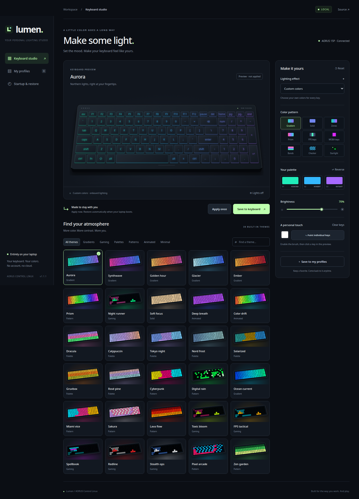
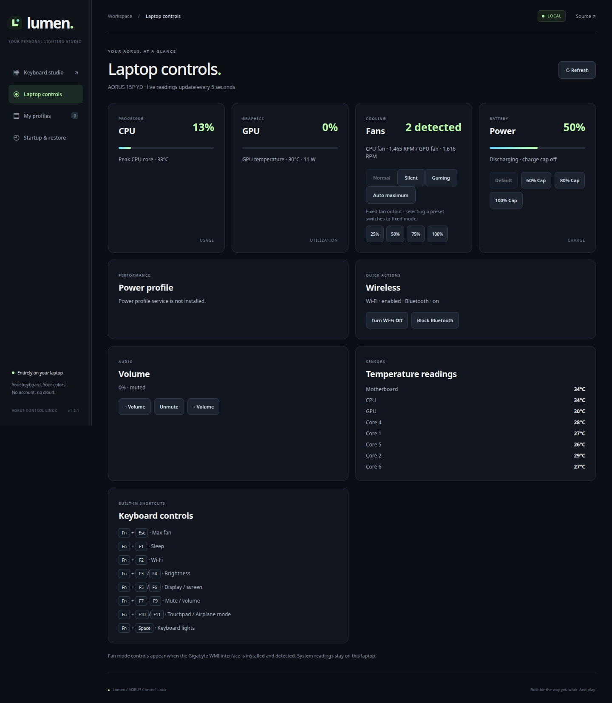
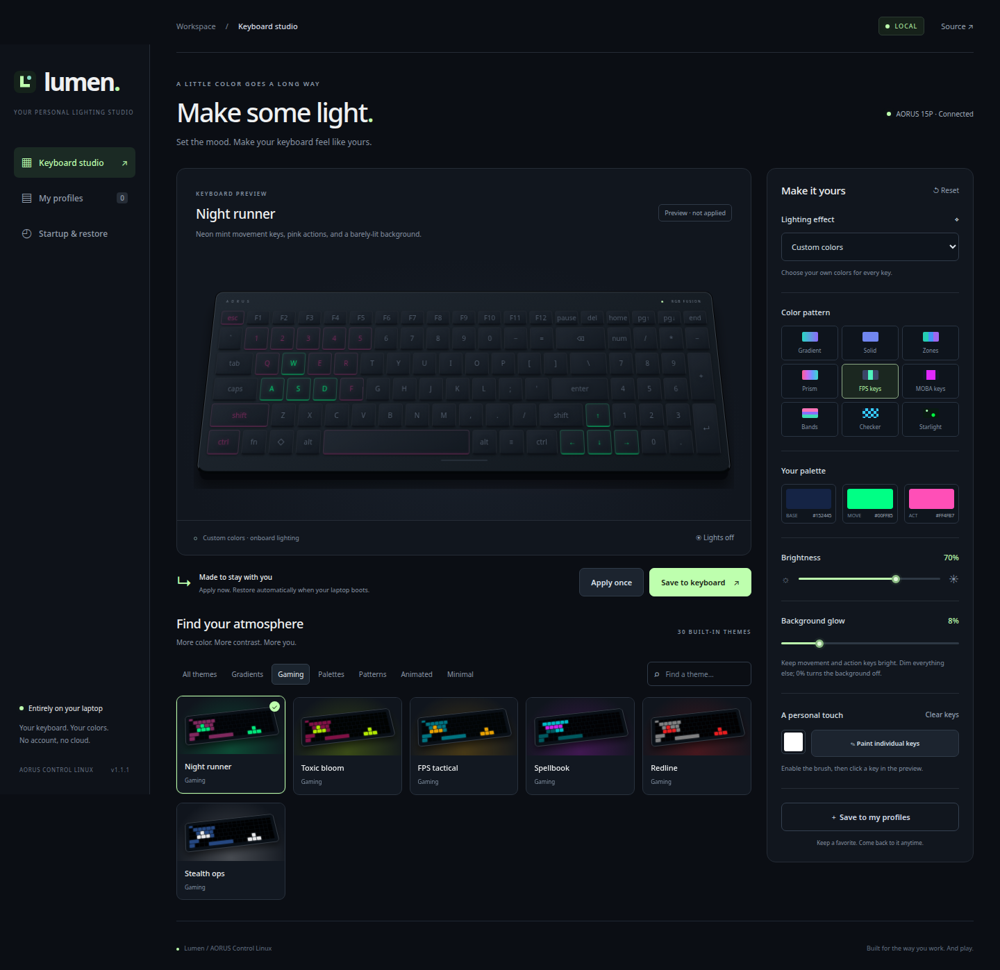

# Lumen · AORUS Control Linux

A local AORUS laptop studio for Linux, with a polished HTML/CSS interface,
keyboard lighting, saved profiles, automatic boot lighting, and live system
controls. Built for the
**AORUS 15P YD's `1044:7a3f` Fusion RGB keyboard**.

**Local only:** the interface runs at `http://127.0.0.1:8765`. There is no cloud
service, account, analytics, external font dependency, or frontend build step.



## Features

- **30 distinct themes**, including six gaming designs and seven palettes
  inspired by Dracula, Catppuccin, Tokyo Night, Nord, Solarized, Gruvbox, and Rosé Pine.
- Solid colors, gradients, zones, horizontal bands, checker patterns, scattered
  lights, a spectrum, and dedicated FPS/MOBA key groups.
- High-contrast gaming layouts with bright movement/spell keys, separate action
  colors, and a **Background glow** slider to dim or switch off the other keys.
- A model-specific **US/ANSI AORUS 15P preview**, including the 19-key function
  row, double-height numpad `+` and Enter, and offset arrow keys.
- Searchable theme cards and saved-profile thumbnails using the same per-key
  colors as the actual device payload.
- Individual key painting, brightness, animation speed, and onboard effects.
- A local profile library with descriptive names and reusable designs.
- **Save to keyboard:** applies now and saves a startup profile on the laptop.
- A system service restores that design **before sign-in** and after sleep.
- A user service starts the local controls at login; an app-menu launcher opens them.
- Native Linux hidraw access; normal keyboard input remains attached to its driver.
- A laptop dashboard for CPU/GPU temperatures and load, fans, battery, and
  available power profiles.
- Quick Wi-Fi, Bluetooth, and PipeWire volume actions when the matching Linux
  system services are available.
- Optional Gigabyte WMI fan modes and charging limits when that external kernel
  driver is installed and exposes controls for the laptop.



## Compatibility

The current backend is specific to USB **`1044:7a3f`**, lighting interface 3,
with the matching Fusion HID descriptor. The reference machine is an AORUS
15P YD running Fedora 43 KDE. A matching laptop brand alone is insufficient.
Other AERO/AORUS machines with this controller may work but need independent
verification. Other USB IDs are intentionally not accepted. The displayed
per-key layout targets the English/US matrix; ISO and Japanese layouts differ.
The physical arrangement was checked against the supplied AORUS 15P US/ANSI
reference, separately from its LED mapping. See [layout validation](docs/KEYBOARD_LAYOUT.md).

Check yours:

```sh
lsusb -d 1044:7a3f
```

The program also checks the exact lighting descriptor, not just the USB ID.
See [protocol and evidence](docs/PROTOCOL.md).

On the reference machine, direct RGB cyan was visually confirmed with typing
intact; Aurora upload and the installed app's save/boot-profile action passed.
See the [validation record and remaining hardware checks](docs/VALIDATION.md).

## Install

Requirements: Linux with systemd/udev, Python **3.10+**, `sudo`, a modern browser,
and a supported keyboard. No third-party Python packages are required. The
installer is intended for a regular desktop session with an active local seat.

```sh
git clone https://github.com/CESARIUX2596/Aorus-Control-Linux.git
cd Aorus-Control-Linux
./install.sh
```

The installer requests administrative access once to install the code,
keyboard access rule, and boot integration. Then open **Lumen Keyboard** from
your app menu, or visit **http://127.0.0.1:8765**.

The first install selects Aurora at 70% brightness. Reinstallation preserves
the previously saved startup design and the user's profile library.

## Use

1. Pick a theme and adjust its colors or brightness in the preview.
2. Choose **Apply once** to change the current lighting without changing startup.
3. Choose **Save to keyboard** to apply and remember the design for boot/resume.
4. Choose **Save to my profiles** to keep multiple designs in your library.
5. Open **Startup & restore** to pause restoration or change the startup design.

For gaming, try **Night runner**, **FPS tactical**, or **Spellbook**. Their
highlight keys stay bright while the rest is dimmed; **Background glow = 0%**
turns the non-action keys off. **Stealth ops** starts with that setting.
Use **Palettes**, **Patterns**, **Gaming**, or the search box to explore the
expanded library. [Theme catalog and palette sources](docs/THEMES.md).



You can close the browser. Static colors and onboard animations continue in
the keyboard. **Permanent flash storage on the keyboard is not implemented**:
the remembered design is saved on the laptop and restored by its system
service. Early firmware/BIOS lighting before Linux starts remains outside the
app's control. Boot and resume timing should be verified on your own system.

## Preview or develop without installation

```sh
python3 server.py --demo
```

Open the printed local address. Demo mode clearly labels itself and never
changes the keyboard. It can preview themes and exercise a separate demo
startup profile. Use `--data-dir /tmp/lumen-demo` to isolate all preview state.

For an already accessible supported keyboard, `python3 server.py` provides
manual control without installing system services. Boot restore still requires
the installer. Don't run the web server as root.

## Installed files and privileges

| Location | Purpose |
| --- | --- |
| `/usr/local/lib/aorus-lighting/` | Root-owned application code and static assets, including laptop telemetry |
| `/etc/systemd/system/aorus-lighting-restore.service` | Root oneshot that restores the validated profile |
| `/etc/systemd/user/aorus-lighting.service` | Unprivileged loopback web server |
| `/usr/lib/systemd/system-sleep/aorus-lighting` | Requests restore after resume |
| `/etc/udev/rules.d/70-aorus-lighting.rules` | Local-seat access to the matching lighting interface |
| `/etc/sudoers.d/aorus-lighting` | Allows the installing user to save only the boot JSON via a fixed helper |
| `/var/lib/aorus-lighting/startup.json` | Validated, root-owned startup profile |
| `~/.config/aorus-lighting/profiles.json` | User profile library |

Laptop telemetry is read from Linux hwmon, NVIDIA, and power-supply interfaces.
Power, radio, and audio actions use fixed allow-listed system commands. Optional
Gigabyte fan and battery controls appear when `/sys/devices/platform/aorus_laptop`
exposes their interfaces. The reference machine has the Fedora 43 WMI driver
installed, and Lumen reads both fan RPMs. See [laptop controls](docs/LAPTOP_CONTROLS.md).

The browser cannot choose device paths, send raw packets, or run arbitrary
commands. State-changing API calls require a per-process token and same-origin
requests. The server accepts loopback hosts only. The root helper validates the
startup profile and accepts only fixed fan-mode and charging-limit presets; the
web server never runs as root.

## Troubleshooting

```sh
# Check the desktop web service
systemctl --user status aorus-lighting.service
journalctl --user -u aorus-lighting.service -b

# Check the last boot/resume restoration
systemctl status aorus-lighting-restore.service
journalctl -u aorus-lighting-restore.service -b

# Test restoration again, including root-owned device access
sudo systemctl start aorus-lighting-restore.service
```

If the page reports missing access, rerun `./install.sh` in your desktop
session. If the device isn't available, check `lsusb` and the exact USB ID.
If port 8765 is already occupied by another application, use `python3 server.py
--port 8766` for manual use; the installed launcher defaults to 8765.
Do not run another RGB controller against the same keyboard concurrently.

## Tests

```sh
python3 -m unittest discover -s tests -v
node --check static/app.js  # optional JavaScript syntax check, needs Node
sh -n install.sh uninstall.sh
```

Tests cover known report/checksum vectors, per-key payload ordering, upload
sequences, input bounds, profile persistence, startup settings, API origin/token
protection, and static-file path restrictions. They also verify 30 distinct
outputs, movement/background contrast, old-profile compatibility, exact preview
colors, and physical key placement/spans. They use demo/fake hardware and do
not establish physical keyboard compatibility by themselves.

## Uninstall

```sh
./uninstall.sh
```

This removes services, access rules, helper, and installed application files.
Your local profile library and startup JSON are retained for reinstallation.
To remove them too, delete the specific saved-data files after reviewing them.

## Project

MIT licensed; see [LICENSE](LICENSE) and [CONTRIBUTING.md](CONTRIBUTING.md).
The [fusion-kbd](https://github.com/magoomby/fusion-kbd) project provided a
useful independent protocol reference. This repository contains an original
hidraw implementation and no proprietary vendor software. It is an independent
project and is not affiliated with GIGABYTE.
